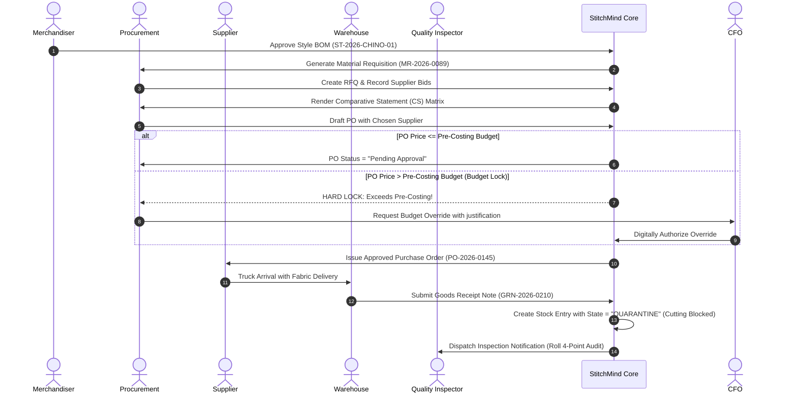

# StitchMind Module Specification
## Module 02: Material Procurement, Commercial Trade (LCs) & Warehouse Quarantine Intake

---

| Metadata Field | Value |
|---|---|
| **Module ID** | `MOD-02` / `Phase B` (Sprint 6–10) |
| **BRD Reference** | Section 4, Module 2 (Procurement) & Module 4 (Stock/Warehouse) |
| **WBS Reference** | `PRO-01` through `PRO-07`, `WHS-01`, `PRO-RPT` |
| **Acceptance Criteria** | `AC-03` (Budget Lock), `AC-04` (Quarantine State) |
| **Status** | Approved Specification |

---

## 1. Business Purpose & Scope

The Material Procurement module translates Merchandising demands into physical raw materials while strictly safeguarding factory profitability and quality compliance:
1. **Demand Generation:** Derives Material Requisitions directly from approved Style BOMs.
2. **Sourcing Optimization:** Compiles Comparative Statements (CS) across multiple suppliers.
3. **Budget Enforcement:** Automatically blocks Purchase Orders exceeding pre-costing budgets.
4. **Trade Finance:** Manages commercial Back-to-Back (B2B) Letters of Credit against Buyer Master LCs.
5. **Quality Gate at Inward:** Places all received goods (GRN) into an immediate **Quarantine Lock** preventing any floor usage until QC inspection passes.

---

## 2. Business Process Flow



---

## 3. Database Schema & Entities

### Schema: `procurement` & `inventory`

```
  ┌────────────────┐           ┌────────────────┐
  │   Supplier     │1         *│   Requisition  │
  └───────┬────────┘           └───────┬────────┘
          │1                           │1
          │*                           │*
  ┌───────▼────────┐1         *┌───────▼────────┐
  │ PurchaseOrder  ├───────────► PurchaseLine   │
  └───────┬────────┘           └────────────────┘
          │1
          │*
  ┌───────▼────────┐1         *┌────────────────┐
  │ BackToBackLC   │           │    GRNEntry    │
  └────────────────┘           └───────┬────────┘
                                       │1
                                       │*
                               ┌───────▼────────┐
                               │  StockLotItem  │ (State: Quarantine)
                               └────────────────┘
```

### Table 1: `procurement.Suppliers`
* `Id` (Guid, PK)
* `SupplierCode` (varchar(20), Unique, e.g. `SUP-TEX-004`)
* `SupplierName` (nvarchar(100), e.g. "Apex Textile Mills Ltd.")
* `Category` (nvarchar(50), e.g. "Fabric", "Thread", "Accessories", "Packaging")
* `PaymentTerms` (nvarchar(50), e.g. "90 Days Deferred B2B LC")
* `CreditRating` (decimal(3,2), e.g. 4.85 / 5.00)
* `BankName` (nvarchar(100))
* `BankSwiftCode` (varchar(20))
* `IsActive` (bit, default 1)

### Table 2: `procurement.PurchaseOrders`
* `Id` (Guid, PK)
* `PONumber` (varchar(30), Unique, Index, e.g. `PO-2026-0145`)
* `SupplierId` (Guid, FK)
* `StyleId` (Guid, FK -> `merchandising.Styles.Id`)
* `PODate` (date)
* `ExpectedDeliveryDate` (date)
* `Currency` (nvarchar(3), default "USD")
* `TotalAmount` (decimal(18,4))
* `Status` (nvarchar(30), e.g. `Draft`, `PendingApproval`, `Approved`, `LockedBudgetExceeded`, `PartialReceived`, `Closed`, `Cancelled`)
* `IsBudgetLocked` (bit, default 0)
* `BudgetOverrideBy` (nvarchar(100), null)
* `BudgetOverrideReason` (nvarchar(250), null)
* `BudgetOverrideAtUtc` (datetime2, null)

### Table 3: `procurement.PurchaseOrderLines`
* `Id` (Guid, PK)
* `PurchaseOrderId` (Guid, FK)
* `BOMItemId` (Guid, FK -> `merchandising.BOMItems.Id`)
* `ItemCode` (nvarchar(30))
* `Description` (nvarchar(200))
* `Quantity` (decimal(18,4))
* `UnitOfMeasure` (nvarchar(20))
* `UnitPrice` (decimal(18,4))
* `BudgetUnitPrice` (decimal(18,4))
* `LineTotal` (decimal(18,4))
* `QuantityReceived` (decimal(18,4), default 0)

### Table 4: `procurement.CommercialLCs` (Trade Finance Ledger)
* `Id` (Guid, PK)
* `LCNumber` (varchar(50), Unique, e.g. `B2B-2026-0098`)
* `LCType` (nvarchar(20), e.g. "MasterLC", "BackToBackLC")
* `ParentMasterLCId` (Guid, null, FK -> self)
* `IssuingBank` (nvarchar(100), e.g. "Standard Chartered Bank")
* `AdvisingBank` (nvarchar(100), e.g. "Eastern Bank PLC")
* `LCAmount` (decimal(18,4))
* `ExpiryDate` (date)
* `ShipmentDeadline` (date)
* `Status` (nvarchar(30), e.g. "Opened", "Transmitted", "DocumentsReceived", "Paid", "Closed")

### Table 5: `inventory.GoodsReceiptNotes` (GRN)
* `Id` (Guid, PK)
* `GRNNumber` (varchar(30), Unique, Index, e.g. `GRN-2026-0210`)
* `PurchaseOrderId` (Guid, FK)
* `SupplierId` (Guid, FK)
* `ChallanNumber` (nvarchar(50), e.g. "CH-99412")
* `VehicleNumber` (nvarchar(30), e.g. "Dhaka Metro-U 11-4589")
* `ReceivedDate` (datetime2)
* `ReceivedBy` (nvarchar(100))
* `TotalRollsReceived` (int)
* `TotalQuantityReceived` (decimal(18,4))

### Table 6: `inventory.StockLots` (Quarantine Gate)
* `Id` (Guid, PK)
* `GRNId` (Guid, FK)
* `BOMItemId` (Guid, FK)
* `LotBatchNumber` (nvarchar(50), e.g. `LOT-TW-2026-01`)
* `WarehouseLocationCode` (nvarchar(30), e.g. `WH1-Aisle-03-Bay-02`)
* `Quantity` (decimal(18,4))
* `UnitOfMeasure` (nvarchar(20))
* `StockState` (nvarchar(20), default "QUARANTINE")  <-- HARD CUTTING BLOCK
* `QCInspectionStatus` (nvarchar(20), default "PENDING")
* `QCPassedAtUtc` (datetime2, null)
* `QCInspectorId` (nvarchar(100), null)

---

## 4. Key Business Logic: Mandatory Quarantine Lock

```csharp
public async Task<Result> VerifyStockAvailableForCuttingAsync(Guid stockLotId)
{
    var stockLot = await _dbContext.StockLots
        .AsNoTracking()
        .FirstOrDefaultAsync(s => s.Id == stockLotId);

    if (stockLot == null)
    {
        return Result.Failure("Stock lot does not exist.");
    }

    // AC-04: Quarantine State Verification
    if (stockLot.StockState == "QUARANTINE" || stockLot.QCInspectionStatus != "PASSED")
    {
        return Result.Failure(
            $"MATERIAL ALLOCATION BLOCKED: Stock lot '{stockLot.LotBatchNumber}' is currently in QUARANTINE. " +
            "Fabric cutting floor requisition requires a verified QC Inspection PASS certificate.");
    }

    return Result.Success();
}
```

---

## 5. Realistic Production Demo Data

### A. Supplier Directory & Comparative Statement (CS)

*Item to Procure:* `FAB-TW-01` (98/2 Cotton Spandex Twill 260 GSM, Total: 36,750 Yards).  
*Pre-Costing Budget Cap:* **$2.4000 / Yard** ($88,200.00 Total Budget).

| Evaluation Parameter | Supplier A: **Apex Textile Mills** | Supplier B: **Square Fashions** | Supplier C: **Envoy Textiles** |
|---|---|---|---|
| **Quoted Unit Price** | **$2.3500 / Yd** | **$2.4500 / Yd** | **$2.3800 / Yd** |
| **Budget Variance** | **-$0.0500 (Savings: $1,837.50)** | **+$0.0500 (Overbudget: $1,837.50)** | **-$0.0200 (Savings: $735.00)** |
| **System Budget Gate** | **PASS (Approved)** | **FAIL (Hard Budget Lock)** | **PASS (Approved)** |
| **Lead Time** | 21 Days | 14 Days | 25 Days |
| **Payment Terms** | 90 Days B2B LC | 60 Days B2B LC | At Sight LC |
| **Quality Rating** | 4.85 / 5.00 | 4.90 / 5.00 | 4.70 / 5.00 |
| **Decision** | **AWARDED CONTRACT** | Rejected (High price) | Backup vendor |

---

### B. Generated Purchase Order: `PO-2026-0145`

* **PO Number:** `PO-2026-0145`
* **Supplier:** Apex Textile Mills Ltd. (`SUP-TEX-004`)
* **Linked Style:** `ST-2026-CHINO-01` (Buyer: Nordic Fashion Retail AB)
* **PO Items:**
  1. `FAB-TW-01` | 36,750 Yards @ **$2.3500 / Yd** = **$86,362.50 USD**
* **Budget Status:** Validated against Pre-Costing cap of $2.4000/Yd. **Result:** Authorized under budget.
* **Payment Terms:** Back-to-Back LC (90 Days deferred maturity).
* **Delivery Target:** 2026-10-10.

---

### C. Trade Finance: Back-to-Back LC Setup

* **Buyer Master LC:** `MLC-NORDIC-2026-4412` (Issued by Swedbank Stockholm for $180,000.00 USD).
* **Back-to-Back LC Issued:** `B2B-2026-0098`
  * **Applicant:** StitchMind Manufacturing Ltd.
  * **Beneficiary:** Apex Textile Mills Ltd.
  * **Amount:** $86,362.50 USD (47.98% of Master LC value, strictly compliant with 70% statutory B2B LC ceiling).
  * **Issuing Bank:** Standard Chartered Bank, Dhaka.

---

### D. Warehouse Inward & Quarantine Entry: `GRN-2026-0210`

* **GRN Number:** `GRN-2026-0210`
* **Delivery Date:** 2026-10-09 (1 day ahead of schedule).
* **Challan:** `CH-99412` | **Vehicle:** `Dhaka Metro-U 11-4589`
* **Quantity Received:** 36,750 Yards across **368 Fabric Rolls**.
* **System Action upon Save:**
  1. Stock Lots generated with `StockState = QUARANTINE`.
  2. Inventory balance updated to 36,750 Yards in warehouse `WH1-Aisle-03-Bay-02`.
  3. Physical cutting floor issue is **locked**.
  4. Work order event dispatched to Quality Control: `QC_INSPECTION_REQUIRED_EVENT` for 4-Point System audit.
