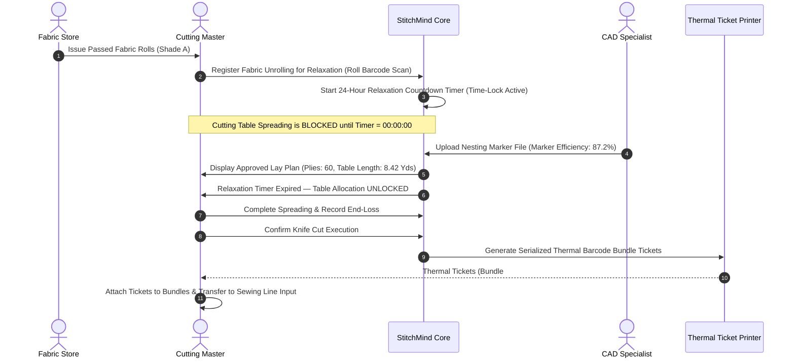

# StitchMind Module Specification
## Module 04: Cutting Department Execution & Bundle Ticketing

---

| Metadata Field | Value |
|---|---|
| **Module ID** | `MOD-04` / `Phase D` (Sprint 11–16) |
| **BRD Reference** | Section 4, Module 5 (Cutting Department) |
| **WBS Reference** | `CUT-01` through `CUT-06`, `WHS-RPT` |
| **Acceptance Criteria** | `AC-04` (Quarantine Gate), `AC-05` (Scan Preparation) |
| **Status** | Approved Specification |

---

## 1. Business Purpose & Scope

The Cutting Department is the bridge between raw material storage and garment manufacturing. Errors made in cutting (e.g., inadequate fabric relaxation, poor marker efficiency, or mixed fabric shades) permanently multiply across thousands of sewn garments.

Module 04 manages:
1. **Mandatory Relaxation Time-Lock Gate:** Enforces 24-hour unrolled relaxation for stretch twill/knit fabrics prior to spreading.
2. **CAD Marker Benchmarking:** Ingests nesting markers (Gerber/Lectra/Optitex) to establish benchmark consumption and calculate fabric efficiency.
3. **Shade-Segregated Lay Planning:** Prevents mixing different shade groups (Shade A vs. B) within the same garment.
4. **Thermal Barcode Bundle Ticketing:** Automatically prints thermal tickets for every cut component bundle to power real-time sewing line tracking.
5. **Remnant & End-Loss Accounting:** Reconciles actual fabric plies against planned consumption to detect material wastage.

---

## 2. The Cutting Operational Sequence



---

## 3. Database Schema & Entities

### Schema: `cutting`

```
  ┌──────────────────┐           ┌──────────────────┐
  │   FabricRoll     │1         *│ RelaxationSession│
  └────────┬─────────┘           └────────┬─────────┘
           │                              │ (Timer <= 0)
           ▼                              ▼
  ┌──────────────────┐1         *┌──────────────────┐
  │    CADMarker     ├───────────►   CuttingOrder   │
  └──────────────────┘           └────────┬─────────┘
                                          │1
                                          │*
                                 ┌────────▼─────────┐
                                 │   CutBundle      │ (Barcode Ticket)
                                 └──────────────────┘
```

### Table 1: `cutting.RelaxationSessions` (Time-Lock Gate)
* `Id` (Guid, PK)
* `FabricRollId` (Guid, FK -> `inventory.FabricRolls.Id`)
* `UnrolledAtUtc` (datetime2)
* `MandatoryDurationHours` (int, default 24)
* `UnlockedAtUtc` (datetime2, computed: `UnrolledAtUtc + Duration`)
* `IsUnlocked` (bit, computed: `DateTime.UtcNow >= UnlockedAtUtc`)
* `AmbientTemperatureC` (decimal(4,1))
* `RelativeHumidityPct` (decimal(4,1))
* `OperatorId` (nvarchar(100))

### Table 2: `cutting.CADMarkers`
* `Id` (Guid, PK)
* `StyleId` (Guid, FK -> `merchandising.Styles.Id`)
* `MarkerName` (nvarchar(100), e.g. `MKR-CHINO-SZ32-34-A`)
* `CADSoftware` (nvarchar(50), e.g. "Gerber AccuMark v16")
* `CuttableWidthInches` (decimal(6,2), e.g. 58.00)
* `MarkerLengthYards` (decimal(8,4), e.g. 8.4200)
* `GarmentsPerMarker` (int, e.g. 4)
* `SizeDistributionRatio` (nvarchar(100), e.g. "32/32: 2 pcs, 34/32: 2 pcs")
* `MarkerEfficiencyPct` (decimal(5,2), e.g. 87.20%)
* `PlannedConsumptionPerPcYds` (decimal(8,4), Formula: `MarkerLength / GarmentsPerMarker`)

### Table 3: `cutting.CuttingOrders` (Lay Planning)
* `Id` (Guid, PK)
* `CutOrderNumber` (varchar(30), Unique, e.g. `CUT-2026-0001`)
* `StyleId` (Guid, FK)
* `MarkerId` (Guid, FK)
* `CuttingTableNumber` (nvarchar(20), e.g. "Table-03")
* `ShadeGroup` (nvarchar(10), e.g. "Shade A")
* `TotalPlies` (int, e.g. 60 plies)
* `TotalGarmentsPlanned` (int, Formula: `TotalPlies * GarmentsPerMarker`, e.g. 240 pcs)
* `ActualFabricConsumedYds` (decimal(18,2))
* `EndLossRemnantYds` (decimal(18,2))
* `CuttingWastageVariancePct` (decimal(5,2))
* `Status` (nvarchar(20), e.g. `Relaxing`, `ReadyForCut`, `InCutting`, `Bundled`, `IssuedToSewing`)

### Table 4: `cutting.CutBundles` (Thermal Barcode Entity)
* `Id` (Guid, PK)
* `BundleBarcode` (varchar(50), Unique, Index, e.g. `BND-2026-0001-01`)
* `CuttingOrderId` (Guid, FK)
* `StyleId` (Guid, FK)
* `ColorName` (nvarchar(50), e.g. "Khaki Beige")
* `SizeLabel` (nvarchar(20), e.g. "32/32")
* `BundleSequenceNumber` (int, e.g. 1)
* `ComponentName` (nvarchar(50), e.g. "Front Panel", "Back Panel", "Waistband", "Fly")
* `QuantityInBundle` (int, e.g. 24)
* `SerialFrom` (int, e.g. 1)
* `SerialTo` (int, e.g. 24)
* `CurrentFloorStation` (nvarchar(30), default "CUTTING_OUTPUT")

---

## 4. Key Business Logic: Fabric Relaxation Time-Lock Validation

```csharp
public async Task<Result> AuthorizeCuttingSpreadingAsync(Guid cuttingOrderId)
{
    var order = await _dbContext.CuttingOrders
        .Include(co => co.AllocatedRolls)
            .ThenInclude(ar => ar.RelaxationSession)
        .FirstOrDefaultAsync(co => co.Id == cuttingOrderId);

    if (order == null) return Result.Failure("Cutting order not found.");

    // Validate that every single fabric roll has completed its 24-hour relaxation
    foreach (var roll in order.AllocatedRolls)
    {
        var session = roll.RelaxationSession;
        if (session == null)
        {
            return Result.Failure($"RELAXATION LOCK: Roll '{roll.RollBarcode}' has not been registered in an active relaxation session.");
        }

        if (!session.IsUnlocked)
        {
            var remaining = session.UnlockedAtUtc - DateTime.UtcNow;
            return Result.Failure(
                $"RELAXATION LOCK ACTIVE: Roll '{roll.RollBarcode}' requires mandatory relaxation. " +
                $"Remaining time: {remaining.Hours}h {remaining.Minutes}m. Spreading prohibited to prevent post-wash shrinkage defects.");
        }
    }

    order.Status = "ReadyForCut";
    await _dbContext.SaveChangesAsync();
    return Result.Success("All fabric rolls fully relaxed. Spreading authorized on Table.");
}
```

---

## 5. Production Demo Data: Cut Order # `CUT-2026-0001`

### A. Relaxation Log
* **Fabric Rolls Unrolled:** 3 Rolls (`ROL-2026-00891`, `ROL-2026-00892`, `ROL-2026-00893`, Total: 512 Yards).
* **Fabric Type:** 98/2 Cotton Spandex Twill (260 GSM).
* **Unroll Time:** 2026-10-10 08:00 AM.
* **Unlock Time:** 2026-10-11 08:00 AM (24 Hours elapsed $\rightarrow$ Status: **UNLOCKED**).

### B. CAD Marker & Spreading Metrics
* **Marker File:** `MKR-CHINO-SZ32-34-A` (Gerber AccuMark).
* **Efficiency:** 87.20% (Benchmark: 86.50% $\implies$ +0.70% fabric saved).
* **Marker Length:** 8.42 Yards (Contains 4 Garments: two 32/32, two 34/32).
* **Plies Laid:** 60 Plies $\implies$ **240 Garments Cut**.
* **Actual Fabric Used:** 508.5 Yards | **End-loss Remnant:** 3.5 Yards (0.68% end loss $\ll$ 2.0% allowable limit).

### C. Sample Thermal Bundle Tickets Generated (Zebra ZPL / Barcode)

```
┌────────────────────────────────────────────────────────┐
│  STITCHMIND FACTORY EXECUTION — CUT BUNDLE TICKET      │
│  Barcode: BND-2026-0001-01                             │
│  Style: ST-2026-CHINO-01       Buyer: Nordic Fashion   │
│  Color: Khaki Beige            Shade: A                │
│  Size: 32/32                   Cut Order: CUT-2026-001 │
│  Component: FRONT PANEL        Bundle #: 01 / 10       │
│  Bundle Qty: 24 Pcs            Serial Range: 001 - 024 │
│  ||||||||||||||||||||||||||||||||||||||||||||||||||||| │
└────────────────────────────────────────────────────────┘
```

* **Total Bundles Generated for Cut # 001:** **10 Bundles** (24 pcs each = 240 pcs).
* **Next Destination:** Dispatched to **Sewing Line 04 (Phase E)**.
